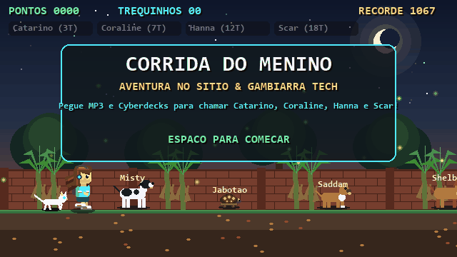

# Corrida do Menino

Jogo de corrida infinita em 2D desenvolvido em Python com Pygame, concebido como versão de computador e bancada de testes para o console portátil R36S (via PICO-8 e TreeFrogUI). Também roda no navegador, empacotado em WebAssembly com Pygbag.

O projeto retrata o cotidiano e o imaginário de Sauron no sítio da família no estado do Pará, reunindo vegetação amazônica e de quintal, aparelhos de tecnologia retrô e gambiarra eletrônica, além dos animais da casa.

## Demonstração



Versão reduzida do mesmo GIF: [`captura-480p.gif`](captura-480p.gif).

## Jogar no Navegador

O jogo também roda direto no navegador, sem instalar nada, graças ao [Pygbag](https://pygame-web.github.io/) (Python + Pygame compilados para WebAssembly):

**https://elen-c-sales.github.io/corrida-do-menino/**

* A publicação é automática a cada push na branch `main`, pelo workflow [`.github/workflows/pages.yml`](.github/workflows/pages.yml) (GitHub Actions + GitHub Pages).
* Na primeira visita, o navegador baixa o runtime Python/Pygame do CDN do Pygbag; por isso o carregamento inicial pode levar alguns segundos.
* O recorde é salvo no `localStorage` do navegador, já que o sistema de arquivos do Pygbag é temporário.
* A tela do jogo (640×360) aparece centralizada, com largura máxima de 960px e proporção 16:9 preservada. Para mudar o tamanho, ajuste a variável CSS `--largura-max-jogo` em `tools/build_web.py`.
* O jogo foi pensado para navegador de desktop com teclado.

> Para ativar a publicação, habilite em **Settings → Pages → Build and deployment → Source: GitHub Actions**. GitHub Pages em repositórios privados exige um plano compatível.

### Gerar a versão web localmente

```bash
pip install -r requirements-web.txt
python tools/build_web.py
python -m http.server 8080 --directory build/web
```

Abra <http://127.0.0.1:8080/>. Também é possível usar `python tools/build_web.py --serve`, que gera o build e sobe um servidor local em <http://127.0.0.1:8080/> (use `--port` para trocar a porta).

Evite servir o build na porta 8000 com outro servidor: o Pygbag reserva essa porta para o proxy de desenvolvimento e o jogo tentaria buscar as dependências nela.

## Dedicatória

Este jogo é dedicado ao querido filho Sauron e aos nossos amados filhotes: Misty, Saddam, Shelby, Catarino, Coraline, Hanna, Scar e Jabotão.

## Ambientação e Mecânica

O protagonista é Sauron, representado como um menino de cabelo comprido castanho que ondula com o movimento da corrida, usando fones de ouvido antigos no pescoço e uma bolsa tiracolo com antena de rádio nas costas.

A partida acontece no quintal do sítio ao entardecer. Ao fundo, aparecem mangueiras frondosas, o muro de tijolinhos da propriedade, touceiras de bananeiras com folhas verdes e secas, vaga-lumes e folhas amarelas caídas sobre a terra batida.

Enquanto corre pelo terreno, os moradores do quintal acompanham a movimentação em segundo plano:

* **Misty**: cadela de porte grande, pelagem branca com cabeça preta, ponta do focinho branca e manchas pretas no dorso.
* **Shelby**: cachorro de porte grande e musculoso, pelagem ruiva avermelhada (red nose), focinho rosado e olhos cor de mel.
* **Saddam**: cachorro de porte mais baixo e robusto, pelagem caramelo dourada com peito branco e língua à mostra.
* **Jabotão**: jabuti amazônico de casco abaulado escuro com placas geométricas amarelo-ocre e escamas alaranjadas nas patas, caminhando no seu próprio ritmo pelo terreno.

### Prêmios Tecnológicos (Trequinhos)

Pelo caminho surgem dispositivos eletrônicos antigos e peças de bancada flutuando em diferentes alturas. O jogador deve saltar para coletar:

1. **Aparelhos MP3**: reprodutores portáteis clássicos com visor LCD iluminado e fone de ouvido.
2. **Cyberdecks**: terminais portáteis montados artesanalmente com tela de fósforo verde, teclado compacto colorido e antena com LED.
3. **Fitas Cassete**: mídias magnéticas clássicas de áudio.
4. **Placas de Circuito**: placas verdes perfuradas com trilhas metálicas, microcontrolador e LED indicador.

### Sistema de Ajudantes (Gatinhos) e Progressão de Dificuldade

À medida que o jogador acumula trequinhos tecnológicos durante a partida, os quatro gatos da família são recrutados como ajudantes. Cada novo ajudante desbloqueado eleva o nível da corrida, introduzindo obstáculos naturais mais complexos no terreno:

1. **Catarino** (desbloqueado com 3 trequinhos): gato branco de olhos azuis e orelhas rosadas, mais jovem e de corpo comprido. Concede impulso extra nos saltos, facilitando a passagem por mudas altas de bananeira.
2. **Coraline** (desbloqueada com 7 trequinhos): gata frajola preta e branca de olhos verdes e corpo magro. Ativa um campo magnético que atrai os trequinhos tecnológicos próximos automaticamente.
3. **Hanna** (desbloqueada com 12 trequinhos): gata branca e gordinha com capuz e manchas redondas rajadas nas costas. Cria um escudo protetor capaz de quebrar um obstáculo caso o jogador tropece. O escudo é recarregado a cada 5 trequinhos coletados.
4. **Scar** (desbloqueado com 18 trequinhos): gato grande e gordinho, com manto rajado nas costas e peito e focinho brancos. Multiplica por dois a contagem de trequinhos coletados e dobra a pontuação de cada item.

O jogador pode alternar livremente entre os gatos já desbloqueados durante a corrida para adaptar a habilidade ativa ao tipo de obstáculo que se aproxima (tocos com raízes, galhos baixos de mangueira com mangas e cipós que exigem agachamento, bananeiras altas e troncos duplos caídos).

## Requisitos e Instalação

* Python 3.7 ou superior
* Biblioteca Pygame 2.0 ou superior
* Pillow (apenas para gerar os GIFs de demonstração)

Para instalar a dependência necessária, execute no terminal:

```bash
pip install pygame
```

Para iniciar o jogo:

```bash
python corrida.py
```

Para a versão web, as dependências de build são instaladas separadamente:

```bash
pip install -r requirements-web.txt
```

## Controles

* **ESPAÇO**, **SETA PARA CIMA** ou **W**: pular
* **SETA PARA BAIXO** ou **S**: agachar (para passar sob galhos de mangueira) ou acelerar a descida durante o pulo
* **C**, **TAB** ou **E**: alternar entre os gatinhos ajudantes desbloqueados
* **1**, **2**, **3**, **4**: selecionar diretamente Catarino, Coraline, Hanna ou Scar (quando desbloqueados)
* **R** ou **ESPAÇO**: reiniciar a partida na tela de fim de jogo
* **ESC**: encerrar o programa (na versão web o ESC é ignorado, para não fechar a aba)

## Estrutura do Repositório

* `corrida.py`: código-fonte completo do jogo, incluindo renderização procedural em pixel art, física, sistema de partículas e lógica de progressão.
* `main.py`: ponto de entrada da versão web, com o loop assíncrono exigido pelo Pygbag.
* `captura.gif`: demonstração do jogo em GIF (640×360, 20 fps) gerada pelo script de captura.
* `captura-480p.gif`: versão reduzida (480×270) da mesma demonstração.
* `tools/captura_gif.py`: gerador dos GIFs de demonstração; usa um autopiloto e não altera o recorde do jogador.
* `tools/build_web.py`: gera a versão web com Pygbag em `build/web/`.
* `pygbag.ini`: lista o que fica fora do pacote web (GIFs, `pico8/`, `tools/` etc.).
* `requirements-web.txt`: dependências para gerar a versão web.
* `.github/workflows/pages.yml`: build e publicação automática no GitHub Pages.
* `recorde.txt`: arquivo de texto gerado e atualizado automaticamente para armazenar a maior pontuação atingida na versão desktop (na versão web o recorde fica no `localStorage`).
* `README.md`: documentação geral do projeto.
* `LICENSE`: texto integral da licença livre MIT.
* `pico8/dino.p8`: versão PICO-8 do jogo, pronta para o R36S com TreeFrogUI.

## Integração com o Portátil R36S

Este repositório serve como bancada de testes para a versão PICO-8, que roda no R36S com TreeFrogUI.

A edição correspondente está versionada neste repositório em `pico8/dino.p8` e também na área de trabalho em `C:\Users\usuario\dev\r36s\roms\pico8\dino.p8`. Para usar no console, copie o arquivo para o diretório `roms/pico8/` no cartão de memória com o ambiente TreeFrogUI configurado.

A versão PICO-8 foi reescrita para acompanhar este projeto e inclui:

* Sauron com cabelo comprido castanho, fone no pescoço e bolsa com antena.
* Cenário do sítio ao entardecer com céu em camadas, mata com parallax e muro de tijolinhos.
* Misty, Shelby, Saddam e o jabuti Jabotão correndo ao fundo.
* Os trequinhos tecnológicos para coleta e os quatro gatinhos ajudantes com seus poderes.
* Toco, galho de mangueira e bananeira como obstáculos.
* Recorde persistido com `dset()`.

### Controles no portátil

* **A** ou **SETA PARA CIMA**: pular
* **SETA PARA BAIXO**: agachar
* **B**: alternar entre os gatinhos desbloqueados

### Outro cartucho disponível

Além do `dino.p8`, também está pronto o cartucho `asteroids.p8`, no mesmo diretório `roms/pico8`, uma versão em Lua do projeto pygame-asteroids.

### Guia completo

O guia de reparo, preparação do cartão, organização dos ROMs e instalação do TreeFrogUI está em `C:\Users\usuario\dev\r36s\guia-reparo-gb350.md`.

## Licença

Este projeto é distribuído sob a Licença MIT (software livre e de código aberto). Você tem liberdade para usar, copiar, modificar, mesclar, publicar e distribuir este código. Consulte o arquivo `LICENSE` para ler os termos completos.
